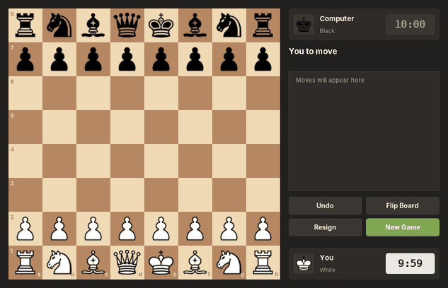
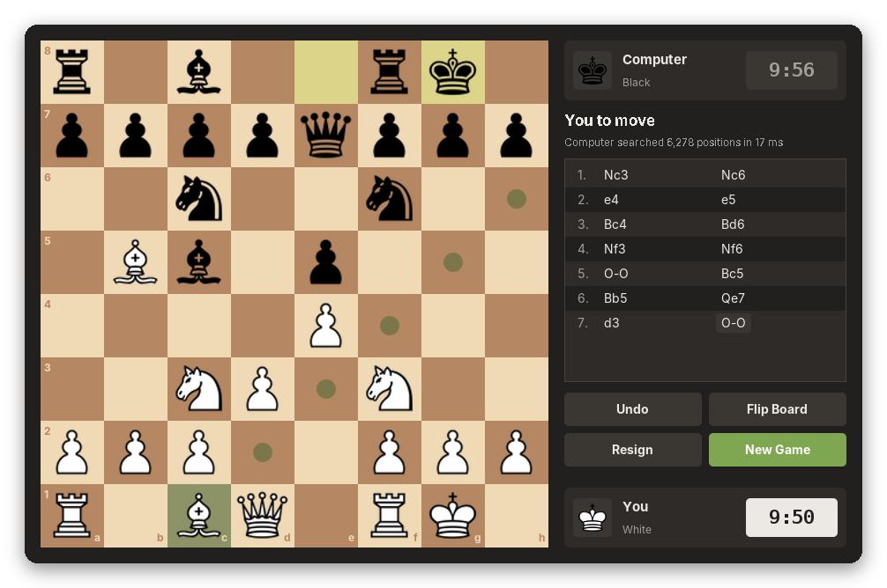
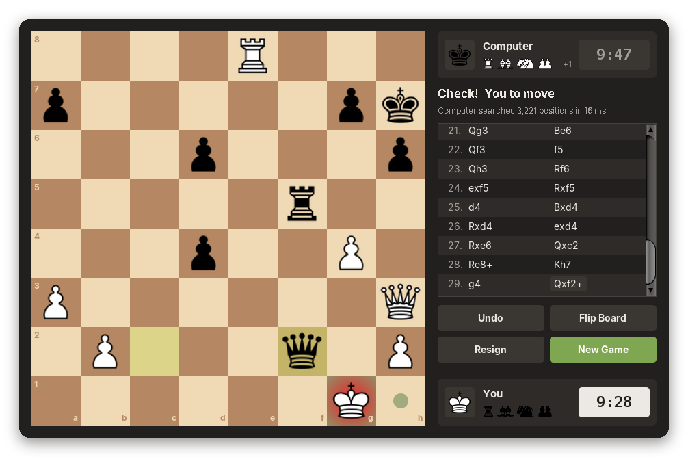
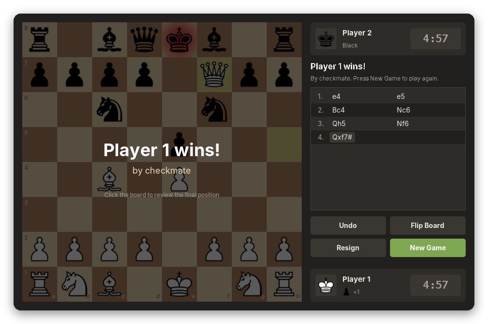
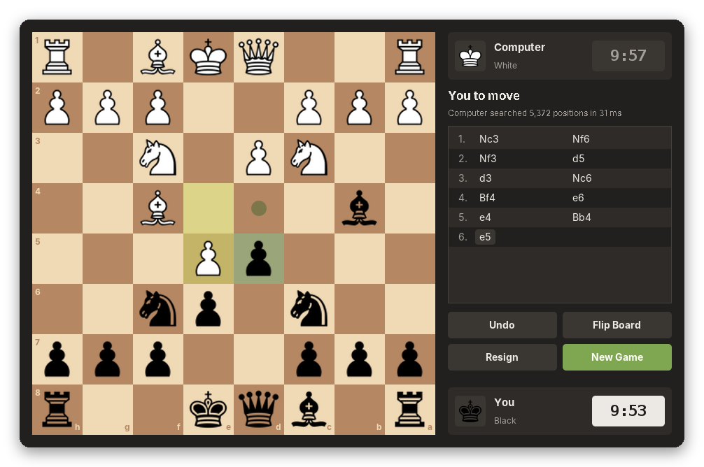
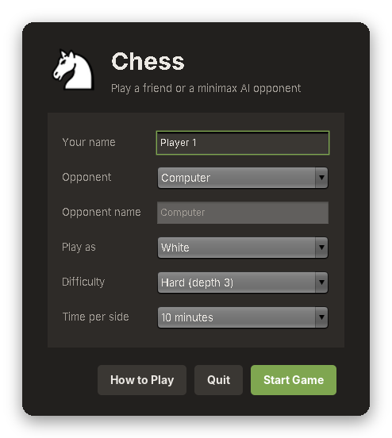
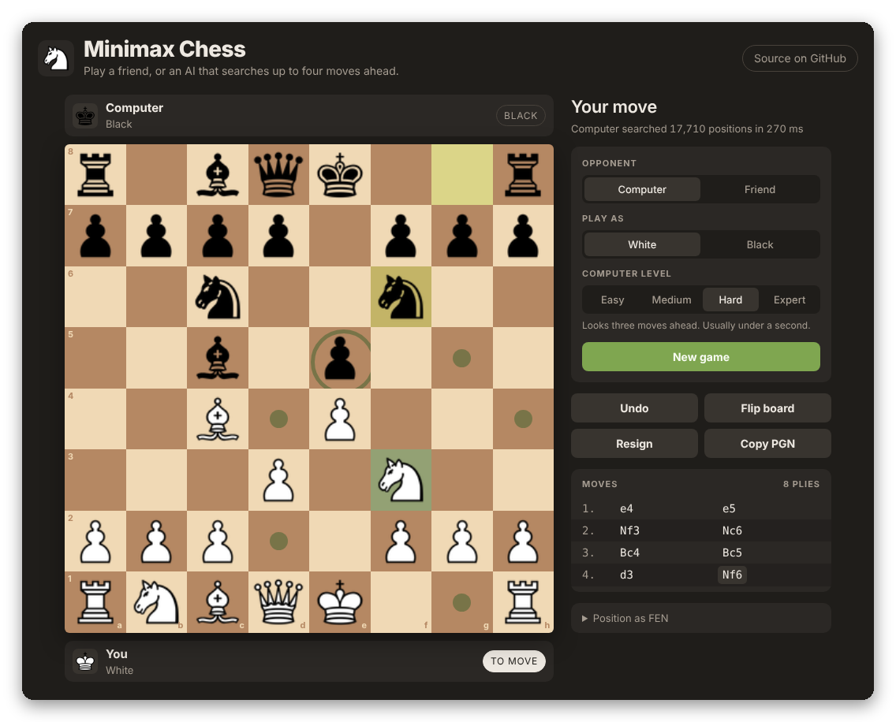

<div align="center">


# Chess

**A complete chess game in Java Swing with a minimax AI opponent, plus a browser version you can play instantly.**

[](https://github.com/2SikNinja/chess/actions/workflows/build.yml)


[**Play in your browser**](https://2sikninja.github.io/Chess/) · [Run the desktop app](#getting-started) · [How the AI works](#how-the-ai-works)



</div>

## Features

**Full rules of chess**
- Every legal move, including castling, en passant and promotion (with a piece picker)
- Check, checkmate and stalemate detection
- Draws by threefold repetition, the fifty-move rule and insufficient material
- Move generator verified with [perft](https://www.chessprogramming.org/Perft) against published node counts

**AI opponent**
- Minimax search (negamax form) with alpha-beta pruning
- Quiescence search so it does not stop counting halfway through a trade
- Material plus piece-square table evaluation
- Five difficulty levels from Easy (1 ply) to Master (5 plies)
- Runs on a background thread, so the window never freezes while it thinks

**Interface**
- Click-to-move or drag-and-drop, with dots for moves and rings for captures
- Last-move highlight and a red glow on a king in check
- Move list in standard algebraic notation (e4, Nf3, O-O, Qxf7#)
- Chess clocks from 1 minute to 1 hour per side, or untimed
- Captured pieces and material count for each player
- Play as White or Black against the computer, or two players on one computer
- Undo, flip board, resign, and keyboard shortcuts

## Screenshots

| Choosing a move | Check |
| :---: | :---: |
|  |  |
| **Checkmate** | **Playing as Black** |
|  |  |

<div align="center">

<p><em>The start menu</em></p>
</div>

### Browser version

The `docs/` folder holds a JavaScript port of the same engine, so anyone can try the game without installing Java. It has the same rules, the same AI (levels 1 to 4) and runs the search in a Web Worker.



## Getting started

You need **JDK 17 or newer**. Check with `java -version`.

### Option 1: Maven

```bash
git clone https://github.com/2SikNinja/chess.git
cd chess
mvn exec:java          # build and play
```

To build a runnable jar and run the tests:

```bash
mvn package
java -jar target/chess.jar
```

### Option 2: No build tool

```bash
./run.sh       # macOS / Linux
run.bat        # Windows
```

These scripts compile with `javac` and launch the game.

### Option 3: IntelliJ IDEA

Open the folder, let IntelliJ import the Maven project, then run `chess.ChessApp`.

## How to play

1. Pick your opponent, color, difficulty and time control, then press **Start Game**.
2. Click a piece to see its legal moves, then click a highlighted square. You can also drag pieces.
3. When a pawn reaches the last rank, choose what it becomes.

| Shortcut | Action |
| --- | --- |
| `Ctrl` + `Z` | Undo (takes back your move and the computer's reply) |
| `F` | Flip the board |
| `Ctrl` + `N` | New game |

On macOS use `Cmd` instead of `Ctrl`.

## How the AI works

The computer chooses moves with **minimax search**: it imagines every move, every reply, every reply to that, and so on to a fixed depth, assuming both sides play their best. It is written in the **negamax** form, which uses the fact that a position worth +3 to White is worth -3 to Black, so one function handles both players.

| Technique | What it does |
| --- | --- |
| **Alpha-beta pruning** | Stops exploring a move as soon as it is proven worse than one already found. Same result as plain minimax, far fewer positions. |
| **Move ordering** | Tries captures first, most valuable victim with least valuable attacker (PxQ before QxP). Good moves found early make pruning much more effective. |
| **Quiescence search** | At the depth limit, keeps following captures until the position is quiet. Without it the AI might "win" a knight without seeing it get recaptured. |
| **Mate distance** | Checkmates are scored by how soon they happen, so the AI goes for the fastest mate. |
| **Evaluation** | Material (pawn 100, knight 320, bishop 330, rook 500, queen 900) plus piece-square tables that reward good squares, with a separate king table for the endgame. |

| Level | Depth | Typical time per move |
| --- | --- | --- |
| Easy | 1 ply | instant |
| Medium | 2 plies | under 0.1 s |
| Hard | 3 plies | under 0.1 s |
| Expert | 4 plies | under 0.5 s |
| Master | 5 plies | 0.5 to 1.5 s |

Times were measured on opening and middlegame positions; busy tactical positions take longer.

## Project structure

```
src/main/java/chess/
├── ChessApp.java          Entry point
├── model/                 Rules of chess, no UI code
│   ├── Board.java         Board state, make/undo move, legal moves, check, FEN
│   ├── Piece.java         Base class, plus King, Queen, Rook, Bishop, Knight, Pawn
│   ├── Move.java          A move (with castling, en passant and promotion types)
│   ├── ChessGame.java     Move history, repetition and game result
│   ├── SanFormatter.java  Standard algebraic notation
│   └── Clock.java         Chess clock
├── ai/
│   ├── MinimaxAI.java     Negamax + alpha-beta + quiescence search
│   ├── Evaluator.java     Material and piece-square tables
│   └── Difficulty.java    Easy to Master
└── ui/                    Swing windows and custom-painted components
    ├── StartMenu.java
    ├── GameWindow.java    Turn flow, background AI search, clocks
    ├── BoardPanel.java    Board drawing, highlights, click and drag input
    ├── PlayerCard.java, MoveListPanel.java, FlatButton.java
    └── Theme.java, PieceImages.java
src/main/java/puzzles/     N-Queens solvers (backtracking practice)
src/test/java/             JUnit tests: perft, rules, notation, AI
docs/                      Browser version (GitHub Pages) and screenshots
```

The model knows nothing about Swing, and the AI only talks to the model. That separation makes the rules easy to test and let the engine be ported to JavaScript for the browser version almost line for line.

## Testing

```bash
mvn test
```

The tests include **perft** runs on four standard positions. Perft counts every position reachable to a fixed depth and compares the total with known-correct numbers, for example 197,281 positions after four plies from the start. A single bug in castling, en passant, promotion or pins changes those numbers, which makes it the standard correctness check for chess move generators. Other tests cover checkmate, stalemate, repetition, insufficient material, notation, and that the AI finds forced mates.

## Publishing the browser version

The browser game is a static site in `docs/`. To put it online with GitHub Pages:

1. On GitHub, open **Settings → Pages**.
2. Under **Build and deployment**, choose **Deploy from a branch**, select `master` and the `/docs` folder, and save.
3. After a minute it is live at `https://2sikninja.github.io/Chess/`.

To try it locally, run `python3 -m http.server` inside `docs/` and open `http://localhost:8000`.

## Possible next steps

- Opening book for more varied early moves
- Iterative deepening with a time limit per move, and a transposition table
- Saving and loading games as PGN files
- Move-by-move replay of finished games

## Author

**Peter Nguyen**

[GitHub](https://github.com/2SikNinja) · [Portfolio](https://ppeternnguyen.com) · [LinkedIn](https://www.linkedin.com/in/phupeternguyen)
